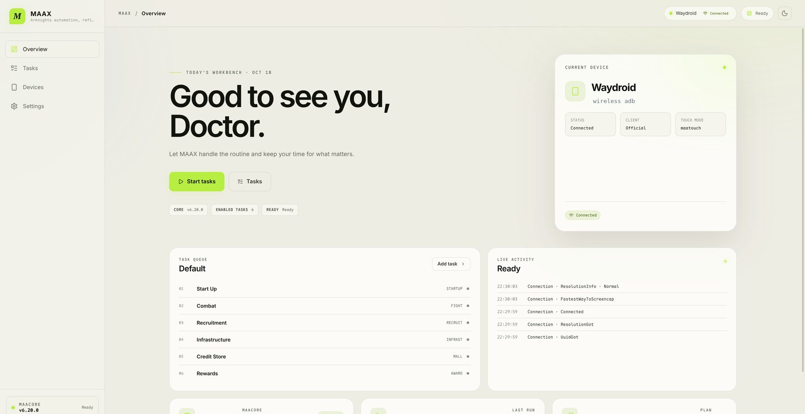

# Maax

Maax 是一个面向 **MaaAssistantArknights / MaaCore** 的现代桌面客户端，使用
**Electron 44 + Solid 2 RC + Effect 4** 构建。它重新实现了已停止维护的 MaaX
的设备上下文、任务队列与核心管理体验，并把内核隔离、多版本回退和类型化错误
作为一等设计。


<details>
<summary>浅色主题</summary>



</details>


## 当前能力

- 本地导入 MaaCore；官方稳定版下载（原生确认框、分阶段安装、可回滚的多版本登记）。
- 设备档案、ADB 连接/断开、实时截图与分辨率信息。
- 每个设备一套任务计划：开始唤醒、理智作战、自动公招、基建换班、信用商店、
  领取奖励、关闭游戏；支持拖动排序、启停和自动保存。
- 理智作战支持代理倍率「自动 / 不切换 / 1–10」，并提供可搜索的关卡推荐列表：
  当前活动（来自 StageActivityV2）、常驻推荐、资源本、芯片本与剿灭；也可直接输入任意关卡代码。
- 运行/停止队列，实时任务链与子任务日志，任务状态投影。
- MaaCore 运行在独立 utility process 中，一个核心版本一个宿主；UI 不会因内核
  回调阻塞或 native crash 一起退出。
- 中文 / English，深色 / 浅色 / 跟随系统。
- Linux 打包产物已包含 koffi 的 native prebuild，并验证过打包后的核心宿主。

## 技术栈

| 范围    | 版本                                                              |
| ------- | ----------------------------------------------------------------- |
| Runtime | Electron `44.9.0` · Node.js `24.22.0`（Electron 内置）            |
| UI      | Solid `2.0.0-rc.15` · `@solidjs/web` · 原生 CSS · Kobalte 2 alpha |
| Effect  | effect `4.0.5` + Effect Schema + `@effect/platform-node`          |
| Build   | Vite 8 · electron-vite 6 · electron-builder 26 · pnpm 12          |
| Quality | TypeScript 7 · `@effect/tsgo` · Oxlint / Oxfmt                    |

## 开发

需要 Node.js 26 与 pnpm 12（Electron 内置 Node 24.22，不要混用宿主 Node 26 的 API）。

```bash
pnpm install
pnpm dev
```

在开发环境中可以通过环境变量直接登记一个本地核心，跳过首次导入：

```bash
MAAX_DEV_CORE=/path/to/MAA-vX.Y.Z-linux-x86_64 pnpm dev
```

`pnpm dev` 打开远程调试端口 `9229`，便于在 Wayland/niri 下做本地 UI 调试；
生产包不开启该端口。

| 命令                 | 说明                                           |
| -------------------- | ---------------------------------------------- |
| `pnpm dev`           | Electron + Vite HMR                            |
| `pnpm lint`          | Effect 规则、type-aware 检查与 TypeScript 诊断 |
| `pnpm format`        | Oxfmt                                          |
| `pnpm check`         | lint + format check                            |
| `pnpm build`         | lint 后构建到 `out/`                           |
| `pnpm package`       | 生成免安装目录 `dist/linux-unpacked`           |
| `pnpm dist`          | 生成 AppImage / deb                            |
| `pnpm bench:startup` | 对比三种启动方式的耗时与内存（见下文）         |

`pnpm bench:startup` 使用同一份 app.asar，分别启动 `linux-unpacked`、
AppImage 和本地 Electron + app.asar，测量到工作台首帧的耗时与稳定后的 PSS/RSS。
准备步骤、指标定义和限制见 [docs/startup-benchmark.md](docs/startup-benchmark.md)。

## 架构

```text
Renderer (Solid, sandboxed)
  │ typed IPC: one command channel + one event channel
Main (Effect: settings, cores, devices, runs)
  │ MessagePort protocol
MaaCore utility process (koffi → libMaaCore.so)
```

MaaCore 会安装进程级信号处理器，且 koffi 回调会阻塞其消息线程；因此它绝不进入
主进程。详细决策见 [docs/architecture.md](docs/architecture.md)，路线图见
[docs/roadmap.md](docs/roadmap.md)。

## 许可

Maax 以 **AGPL-3.0-or-later** 发布。MaaCore / MaaAssistantArknights 是独立的
AGPL-3.0 项目，不随安装包分发；用户在自己选择的目录中安装或导入。第三方组件
与许可说明见 [NOTICE](NOTICE)。
